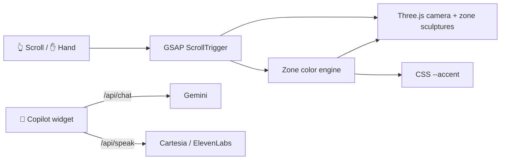

<!-- ════════════════════════ HEADER ════════════════════════ -->
<div align="center">


<a href="https://YOUR-LIVE-URL">
  
</a>

<br/>

<a href="https://YOUR-LIVE-URL"></a>
<a href="https://github.com/HassanKhalid8/Hassan-Portfolio/stargazers"></a>


</div>

<br/>

> **Not a page, a flight.** Scrolling drives a camera through a star tunnel. Every section is a
> color-themed *zone* with its own floating wireframe sculpture, and the whole site (3D fog,
> star dust and every CSS accent) shifts color as you cross from one zone to the next.

<!-- ════════════════════════ FEATURES ════════════════════════ -->
## ✦ Highlights

<table>
  <tr>
    <td width="50%" valign="top">
      <h3>🚀 Scroll-driven flight</h3>
      Three.js camera journey through a star field, synced to scroll with GSAP ScrollTrigger.
      Sculptures are re-anchored to real section heights, so colors never drift.
    </td>
    <td width="50%" valign="top">
      <h3>🎨 11 color zones</h3>
      Each section has its own color. Colors blend only during the hand-off between
      sections and hold steady while a section fills the screen.
    </td>
  </tr>
  <tr>
    <td valign="top">
      <h3>🤖 AI copilot</h3>
      A Gemini-backed chat that knows my projects, experience and certifications, with an
      offline fallback and optional voice replies in my cloned voice.
    </td>
    <td valign="top">
      <h3>✋ Optical nav</h3>
      Hands-free scrolling with MediaPipe hand tracking. Palm up / down scrolls, a fist stops.
      Everything runs in-browser and no video ever leaves the machine.
    </td>
  </tr>
  <tr>
    <td valign="top">
      <h3>🏅 Certificate vault</h3>
      Hover-flip credential cards, a scanner-beam entrance, a live registry counter and a
      full-size lightbox.
    </td>
    <td valign="top">
      <h3>🎬 Short films + 📄 CV</h3>
      Trailers from the GIKI Media Club productions, plus a one-click A4 CV generated from
      HTML with headless Chrome.
    </td>
  </tr>
</table>

<!-- ════════════════════════ ZONES ════════════════════════ -->
## 🌌 The journey

| # | Zone | Color | Sculpture flavour |
|:-:|------|:-----:|-------------------|
| 001 | **Launch** |  | countdown → ignition |
| 002 | **About** |  | who I am |
| 003 | **Skills** |  | the toolkit |
| 004 | **Web Projects** |  | shipped & live |
| 005 | **Engineering Lab** |  | hardware, DSP, ML |
| 006 | **Experience** |  | internships & roles |
| 007 | **Certifications** |  | the credential vault |
| 008 | **Education** |  | GIKI & beyond |
| 009 | **Short Films** |  | AKS · INIKAAS · BARZAKH |
| 010 | **Interests** |  | off the clock |
| 011 | **Contact** |  | say hi |

<!-- ════════════════════════ STACK ════════════════════════ -->
## 🛠️ Built with

<p align="center">
  
</p>

<p align="center">
  
  
  
  
</p>



<!-- ════════════════════════ RUN ════════════════════════ -->
## ⚡ Run it locally

```bash
git clone https://github.com/HassanKhalid8/Hassan-Portfolio.git
cd Hassan-Portfolio
node server.js        # → http://localhost:3000
```

No dependencies and no build step. `server.js` serves the static site and mounts the `/api` routes the same way Vercel does in production.

<details>
<summary><b>🔑 Optional: enable the AI copilot & voice</b></summary>
<br/>

Copy `.env.example` → `.env` and fill in what you need:

| Variable | Purpose |
|----------|---------|
| `GEMINI_API_KEY` | Live copilot replies (free key from Google AI Studio). Without it, chat runs in offline mode. |
| `CARTESIA_API_KEY` + `CARTESIA_VOICE_ID` | Voice replies in a cloned voice (preferred) |
| `ELEVENLABS_API_KEY` + `ELEVENLABS_VOICE_ID` | Alternative voice provider |

</details>

<details>
<summary><b>📄 Rebuild the CV PDF</b></summary>
<br/>

```bash
node assets/cv/build-pdf.js   # assets/cv/resume.html → assets/CV.pdf (A4)
```

</details>

<details>
<summary><b>🗂️ Project structure</b></summary>
<br/>

```
├── index.html          # all content & sections
├── css/style.css       # design system, zone-aware theming
├── js/
│   ├── main.js         # 3D scene, zone colors, scroll animations
│   ├── chat.js         # AI copilot widget
│   └── gesture.js      # MediaPipe optical nav
├── api/
│   ├── chat.js         # Gemini endpoint
│   ├── speak.js        # voice (TTS) endpoint
│   └── _knowledge.js   # what the copilot knows about me
├── assets/             # images, certificates, CV
└── server.js           # zero-dependency local dev server
```

</details>

<!-- ════════════════════════ CONTACT ════════════════════════ -->
## 📡 Get in touch

<p align="center">
  <a href="https://www.linkedin.com/in/hassankhalid8/"></a>
  <a href="https://github.com/HassanKhalid8"></a>
  <a href="mailto:hassank8125@gmail.com"></a>
</p>

<!-- ════════════════════════ FOOTER ════════════════════════ -->
<div align="center">


</div>
